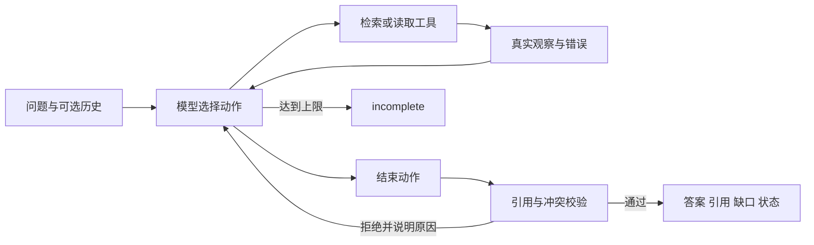

# 调用流程与技术取舍

采用 Python 原生有界循环，openai SDK 负责访问 DeepSeek 的兼容 Chat Completions 接口，Pydantic 负责输入、动作和资料契约，dotenv 读取本机配置。SDK版本 openai 3.40.0，模型请求名与服务返回名为 deepseek-flash。没有采用 Agent 框架，避免引入本题不必要的Runtime职责；依赖精确版本见 requirements.txt。

工具通过一个 select_action 函数契约接收 search/read/finish 提议。模型每轮看到请求、历史、本次实际观察和剩余次数；执行层不预先决定检索词、读取哪个文档、是否补检或何时结束。select_action 是动作选择通道，业务工具是 KnowledgeBase.search/read。Trace仅保存可公开的一句动作依据，不保存内部推理、授权头或密钥。

检索以中文双字/英文词为基础，使用词频及逆文档频率加权；同义词扩展报账→报销、时限→期限、居家上班→远程办公。它不是完整BM25或向量检索。命中后合并相同rule_key的其他版本，防止单个版本排位较低而隐藏冲突。每页5项，模型需继续分页，执行层阻止跳过已发现的未读分页后直接回答。

读取工具按doc_id/chunk_id返回当前运行冻结的原文与版本日期。搜索preview不得引用。模型选择完整原子片段引用，执行层要求quote逐字等于实际读过的片段，再以这些引用构造抽取式答案。因此最终事实不由模型自由增写。每次运行记录资料SHA256，每个验收目录保留对应corpus.json，改文档后新建KnowledgeBase会重新索引。

冲突由模型识别并选择处理动作，执行层另有保守约束：同rule_key下去除空白后的文本不同就视为潜在冲突，不根据日期挑赢家。若只读一方就回答、只引用一方、遗漏缺口或追问，finish被拒绝并将原因反馈模型。相同含义的不同表述也可能被保守判冲突；当前合成资料没有自动适用范围/优先级解析，优先选择请求人工确认。

真实案例展示差异路径：normal检索→读取→answered；conflict读取两个版本→conflict并追问；outside补检→not_found；tool_failure根据观察重试/改词→tool_error。各步的query、文档ID、返回原文/摘要与下一步均在examples/live/*/trace.json内。next step是紧接的下一条模型动作；达到上限时直接返回明确incomplete。

服务兼容问题：实测DeepSeek即使接收parallel_tool_calls=False，仍可能提出多个函数动作。最初严格拒绝造成失败，保存在examples/experiments/。修复后只执行第一个提议，丢弃其余，下一轮依据真实结果重新决策；meta.discarded_parallel_calls记录数量。未执行的提议绝不伪装成成功观察。

上限为12次模型决策，工具调用次数不超过该值；参数范围1..30。单次模型超时45秒，SDK自动重试为0。工具错误交给模型决定调整或停止，模型异常/格式无法解析则明确incomplete，不伪造答案；未来可增加格式修复回合。

官方参考：[DeepSeek兼容接口](https://api-docs.deepseek.com/)、[OpenAI函数调用文档](https://developers.openai.com/api/docs/guides/function-calling)。本项目使用实测服务名，不假定所有兼容服务行为一致。
